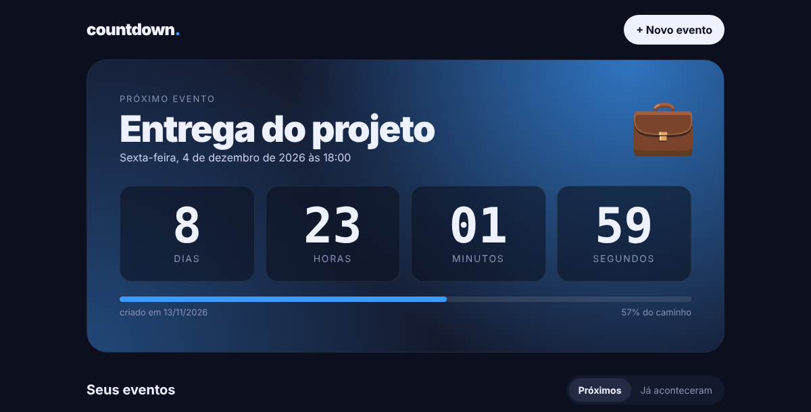

# CountdownApp — Contagem regressiva

Contador regressivo para eventos importantes, com dias, horas, minutos e segundos e vários eventos ao mesmo tempo.

🔗 **[Ver o site no ar](https://iamviniciuslima05.github.io/PROJETO-CountdownApp/)**



## Funcionalidades

- **Vários eventos** ao mesmo tempo
- Dias, horas, minutos e segundos **ao vivo**
- O **próximo evento** aparece em destaque (ou o que você fixar)
- Eventos que **repetem todo ano** (aniversários, Natal…)
- Barra de **progresso** desde a criação
- Aba de eventos que **já aconteceram**
- Ícone e cor para cada evento
- Contagem no **título da aba**

## Tecnologias

HTML5 · CSS3 · JavaScript · localStorage

## Estrutura

```
index.html
css/style.css
js/script.js
```

## Como rodar

Não precisa instalar nada: baixe o projeto e abra o `index.html` no navegador, ou acesse a versão publicada acima.

---
Feito por **Vinicius Lima** · [Portfólio](https://viniciuslimadev.netlify.app) · [LinkedIn](https://www.linkedin.com/in/viniciuslima25/)
